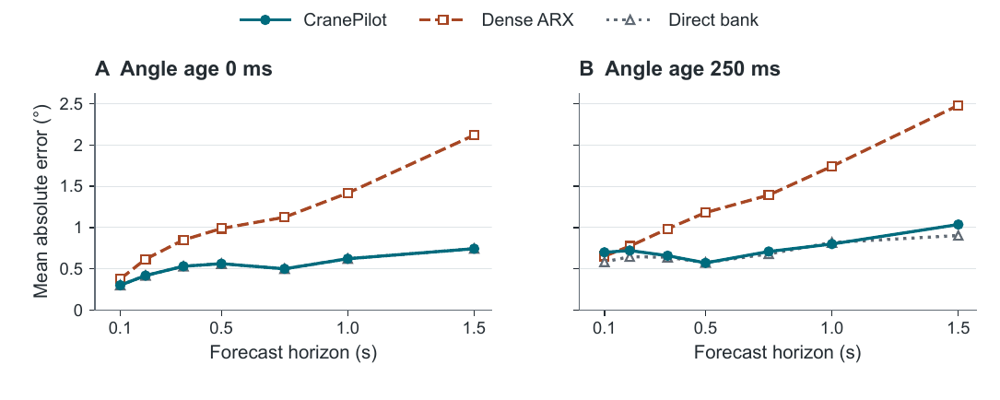

# CranePilot

Forecasting tower-crane payload sway when angle measurements arrive late. CranePilot uses past angle and crane motion to predict sway from 0.10 to 1.50 seconds ahead. This repository contains the manuscript, the frozen predictors, and the experiment records.

[Read the manuscript (PDF)](paper/CranePilot_Manuscript.pdf) · [Manuscript source and figure data](paper/README.md) · [Research notes](docs/README.md)

## Results

The latest comparison replays seven previously inspected recordings from the 100 Hz Inteco dataset. The baseline is a validation-selected autoregressive model with exogenous inputs (ARX).



At an angle age of 250 ms, with no added noise, the average over seven horizons favors CranePilot. Dense ARX has lower error at the 100 ms horizon.

| Mean absolute angle error | CranePilot | Dense ARX |
| --- | ---: | ---: |
| Average over seven horizons | 0.742° | 1.316° |
| 100 ms horizon | 0.700° | 0.653° |

An additional replay changed only the reported angle age. Over the five tested interior ages, a +20 ms reporting error raised CranePilot's mean absolute error from 0.581° to 0.869°. Both studies reuse the same laboratory recordings and simulate timing errors. Independent physical validation is pending.

[Horizon results](results/dense_horizons_20261109/paired_horizon_summary.csv) · [Timestamp results](results/timestamp_offset_20261109/common_interior_offset_means.csv) · [Confirmation protocol](docs/FRESH_CONFIRMATION_20261108.md)

## Run the checks

The repository's continuous integration uses Python 3.12 and CPU PyTorch. From the repository root:

```sh
python -m venv .venv
source .venv/bin/activate
python -m pip install -e .
python -m unittest discover -s tests -v
```

The [forecast API](docs/DATED_BUNDLE_20261108.md) takes a known measurement age and four seconds of history per channel. Its [frozen forecast bundle](artifacts/dated_bundle_20261108) and [dense ARX bundle](artifacts/dense_reference_bundle_20261108) are included. The inference API and unit tests can run without downloading the source recordings.

## Repository layout

| Path | Contents |
| --- | --- |
| [`paper/`](paper) | LaTeX, bibliography, and manuscript figures |
| [`src/cranepilot/`](src/cranepilot) | Forecasting models, data import, and benchmarks |
| [`configs/`](configs) | Experiment settings and record-level splits |
| [`artifacts/`](artifacts) | Frozen model bundles |
| [`results/`](results) | Saved predictions, metrics, and verification reports |
| [`docs/`](docs/README.md) | Evaluation protocols and research reports |

## Data and citation

The source is the [33-record Inteco tower-crane dataset, version 2](https://doi.org/10.17632/x69hyyv3zw.2) (CC BY 4.0). See the [dataset paper](https://doi.org/10.1016/j.dib.2025.111822) and the [benchmark card](docs/BENCHMARK_CARD.md) for the experiment design. Cite the dataset authors and [CranePilot](CITATION.cff) when reusing this work. The code is available under the [MIT license](LICENSE).
