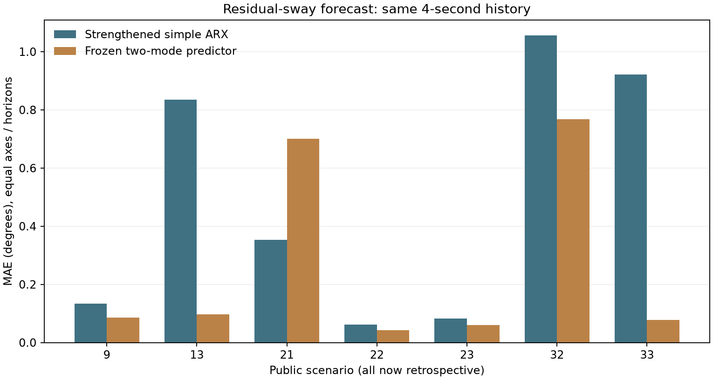

# Существенный результат, но независимая цель ещё открыта

**Локальная оценка двух колебательных мод по4sистории** дала MAE **0.261421°**
против **0.492306°** у более сильного простого ARX: **−46.90%,6/7условий**.
Парный bootstrap7целых сценариев:95%описательный интервал
**[−85.05%,+15.60%]**, включает0. Поэтому уверенного статистического
превосходства пока нет. Scenario21 остаётся явным проигрышем: .7000° vs .3535°.

Это отдельная задача остаточных колебаний при settled-input gate, не исходная
.4sактивная задача и не closed-loop испытание. Обоим методам даны одинаковые
4sистории и TRAIN записи. Новый алгоритм — классическая modal identification,
не новая нейросетевая архитектура. Нейросеть для этого улучшения не требуется.

Что изменилось в доказательствах:

- Первые равные-data adaptation и shared-response этапы дали только4–5%
  validation выигрыша; дообученные сети хуже сильного ARX. Все неудачи сохранены.
- Новый modal protocol закоммичен до fitting; development−26.38%,4/5cases.
- 7 ранее не оценивавшихся публичных условий открыты один раз после freeze:
  .261421° vs2.338230° у первоначального full-input ARX,−88.82%,6/7wins.
  Данные ранее импортировались; новая независимая физическая запись не получена.
- Проверка слабости comparator добавила240простых/invariantARX fits. Выбор только
  по прежним validation; сама проверка спроектирована после первых holdout scores.
  Более сильная база .492306° существенно уменьшила разрыв. Поэтому рабочий
  вывод использует−46.9% и широкий интервал, а не только эффект−88.8%.
- После этого все33сценария открыты для оценивания; повторные подборы на них
  исключительно retrospective. Свежую независимую проверку ими заменить нельзя.

Проверено:200unit tests PASS;37704frozen conditional forecasts воспроизведены
точно; все120первых и240дополнительныхARX fits/метрики проверены. Старые прогнозы
не менялись. Все1281исходный файл main/APHYNITY сохранён. Пять случаев нового
portable API совпали с сохранёнными прогнозами и усиленным ARX точно.
Median single-packet latency11.3–11.6ms, не hard-real-time гарантия.

Готов переносимый [комплект](MODAL_BUNDLE_20261107.md):12files,107738bytes,
без исходных данных/обучения/ancestral runs для inference. Это дополнительный
экспериментальный профиль; исходные defaults и APHYNITY не заменены.

Пользователь может запросить новые данные Talapiden/Alhassan. Конкретные сигналы
и порядок независимой проверки: [AUTHOR_DATA_INTAKE](AUTHOR_DATA_INTAKE_20261107_RU.md).
Агент авторам не писал. До получения подходящих raw trials общая цель
доказанного независимого преимущества остаётся открытой; SOTA/аппаратный выигрыш
не заявляются. Дальнейший перебор на33открытых условиях не устранит этот пробел.

Подробные отчёты: MATCHED_ADAPTATION_2026_11_07_RU.md,
SHARED_RESPONSE_2026_11_07_RU.md, MODAL_DEVELOPMENT_2026_11_07_RU.md,
MODAL_CONFIRMATION_2026_11_07_RU.md, MODAL_REFERENCE_CHALLENGE_2026_11_07_RU.md.
