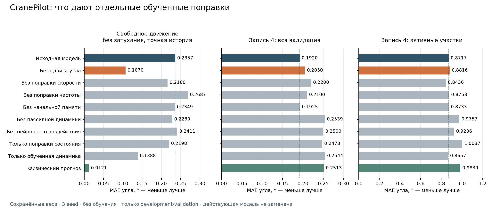

# Проверка физических пределов основной модели — 7 ноября 2026

Выполнена диагностика сохранённых весов основной версии. Самое заметное
улучшение свободного движения среди отдельных отключений даёт удаление
поправки начального угла. Однако та же поправка полезна на измеренных данных:
её удаление ухудшает общую валидационную ошибку у всех трёх seed.
Действующая модель `forced_driven_huber` остаётся прежней.

Нового обучения не было. APHYNITY не изменялся. Тестовые записи и отложенная
новая сетка симуляции не оценивались. Публикаций в GitHub/Overleaf не было.

## Что проверено

Протокол и код зафиксированы до запуска: `0e88122`; численная корректировка —
`de16078` в локальной ветке `research/limit-audit-20261107`.
Использованы три исходных primary seed, прежний замороженный привод и
калибровка, полученная только по обучающим записям 3/5/6.

Десять заранее заданных вариантов: исходная модель; шесть отдельных отключений
поправок угла, нормализованной угловой скорости, частоты, начальной памяти,
пассивной динамики, нейронного воздействия; только поправки состояния;
только обученная динамика; физический прогноз без обученных поправок.
Веса не редактировались. После каждого вмешательства hooks и режим модели
восстанавливаются. Воздействие GRU пересчитывается на изменённой траектории.

Измеренные данные: по 972 окна на обучающих записях 3/5/6 и валидационной
записи 4. Активных окон соответственно 27/36/9/50; активность определяется
исключительно по прошлой скорости тележки, |v| >= 0.005 м/с.
Семь горизонтов имеют равный вес; при объединении обучения записи тоже
имеют равный вес. Сначала усредняются прогнозы трёх seed, затем считается MAE.

Симуляция: прежние 288 физических траекторий, каждая с точной и квантованной
историей, всего 576 случаев. Это уже изученный набор для разработки.
В приведённом ниже пределе без затухания с точной историей 96 случаев.
Привод здесь обходится: ускорение точно равно нулю для всех вариантов.

## Результаты

MAE угла в градусах, меньше — лучше. Таблица не является выбором новой модели.

| Вариант | Свободное движение без затухания, точная история | Валидация целиком | Активная валидация |
|---|---:|---:|---:|
| Исходная модель | 0.235730 | 0.192027 | 0.871701 |
| Без сдвига начального угла | 0.106960 | 0.204989 | 0.881596 |
| Без поправки нормализованной скорости | 0.216018 | 0.219970 | 0.843596 |
| Без поправки частоты | 0.268688 | 0.210027 | 0.875795 |
| Без начальной памяти | 0.234896 | 0.192459 | 0.873323 |
| Без пассивной динамики | 0.227978 | 0.253872 | 0.975684 |
| Без нейронного воздействия | 0.241098 | 0.250040 | 0.923613 |
| Только поправки состояния | 0.219770 | 0.247329 | 1.003651 |
| Только обученная динамика | 0.138799 | 0.254446 | 0.865663 |
| Физический прогноз | 0.012128 | 0.251284 | 0.983910 |



Удаление сдвига угла уменьшает ошибку указанного свободного движения на 54.63%,
но увеличивает общую валидационную ошибку на 6.75%, активную — на 1.14%.
Улучшение симуляции и ухудшение общей валидации происходят у всех трёх seed:

| Seed | Свободное: исходная → без сдвига | Валидация: исходная → без сдвига |
|---|---:|---:|
| 0 | 0.251567 → 0.110380 | 0.201954 → 0.216704 |
| 1 | 0.245544 → 0.090321 | 0.201687 → 0.215645 |
| 2 | 0.221439 → 0.146423 | 0.191060 → 0.203242 |

На всех синтетических случаях вместе ошибка без сдвига уменьшается с 0.250703
до 0.146539°. С квантованной историей без затухания — с 0.234470 до 0.106042°.
Полный набор результатов по затуханию, длине, сценариям, горизонтам и seed
сохранён рядом с отчётом; благоприятный частный результат не заменяет остальные.

Удаление нейронного воздействия ухудшает свободный недемпфированный предел
на 2.28% и общую валидацию на 30.21%. Следовательно, одного его отключения
недостаточно для исправления выявленного физического нарушения. Обученные
поправки состояния и динамики взаимодействуют; эффекты отключений не складываются.
Например, отключение всех поправок состояния даёт 0.138799° в свободном
движении, что хуже удаления одного сдвига угла.

Средний модуль сдвига угла по трём seed и окнам: около 0.2258° на синтетическом
наборе и 0.0851° на валидации. Это описание выхода сети, а не оценка реальной
ошибки датчика. Участие сдвига в ошибке прогноза подтверждается вмешательством;
из него нельзя заключать, что установлена физическая причина ошибки крана.

## Численная проверка и сохранность

54/54 теста прошли, включая пять новых: совпадение исходного forward,
аналитический физический предел, сохранность весов/режимов после вмешательств,
независимость от будущих измерений и отказ в режиме обучения.

Первый float32-запуск остановился на проверке физического предела записи 3:
5.39687e-5° при допуске 5e-5°. Он сохранён как неудачный технический запуск
`artifacts/runs/limit_audit_20261107`. После перехода всех угловых вариантов
к float64 максимальная разница с аналитической формулой стала 1.05e-13°.
Привод остался float32; файлы весов неизменны. Допуски не увеличивались.

Полный завершённый запуск: `artifacts/runs/limit_audit_20261107_float64`.
Совпадение исходного варианта с сохранёнными прогнозами: максимум 2.054e-5°
на синтетике и 3.142e-5° на всей валидации, оба ниже исходного допуска 5e-5°.
Симуляционные цели воспроизведены с допуском 1e-12 рад; разница RK4 при
половинном шаге — 1.357e-9°. Источники, данные и веса проверены по SHA256
до запуска и после него. Сохранены прогнозы каждого seed, не только средние.

## Следующая проверяемая гипотеза

Следующий кандидат должен ограничивать начальную поправку угла величиной
несогласованности каузального физического наблюдателя с прошлой историей.
Простой вариант для отдельного заранее зафиксированного эксперимента:

`delta_q = tanh(h(context)) * min(0.02 rad, RMS(past_observer_residual))`.

В нём сдвиг исчезает при точно согласованной истории, а ограничение 0.02 рад
не превышает прежний максимум. Это гипотеза, не реализованная или проверенная
в этом этапе новая модель. Квантование и неверная физическая модель могут
создавать невязку сами; поэтому нулевая невязка не является надёжным индикатором
истинности всей динамики. Ограничение одного сдвига также не гарантирует
физический предел всей системы: остаются частота, скорость, память и воздействие.

Для проверки нужен согласованный до обучения протокол: исходная архитектура
как контроль с тем же бюджетом; все три seed; исходные границы train/validation;
отдельное ограничение ухудшения общей и активной валидации; сохранение всех
неудачных вариантов. Новая сетка из конфигурации диагностики уже зарезервирована
и не вычислялась. Её следует открыть один раз после фиксации кандидата и правил
выбора. Это дополнительная сетка того же симулятора, а не независимый реальный кран.
Подбор по прежним тестовым записям не допускается.

Мотивация контроля добавленной динамики связана с
[APHYNITY, Yin et al.](https://arxiv.org/abs/2010.04456), где физическая и
обученная части разделяются в задаче оптимизации. Выполненная здесь диагностика
не воспроизводит этот метод и не меняет отрицательный результат отдельного пилота.

## Файлы и воспроизведение

- [Зафиксированный дизайн](LIMIT_AUDIT_DESIGN_20261107.md).
- [Таблица всех вариантов](../results/limit_audit_20261107/summary.csv).
- [Структурированный отчёт](../results/limit_audit_20261107/report.json).
- [Числа по каждому seed](../results/limit_audit_20261107/per_seed_summary.csv).
- [Разбиение синтетики по длине](../results/limit_audit_20261107/synthetic_length_breakdown.csv).

Из корня основного проекта, через его окружение, выбрать новые выходные папки:

```sh
python -m scripts.audit_limits --config configs/limit_audit_20261107_float64.json --output artifacts/runs/NEW_AUDIT
python -m scripts.report_limit_audit --run artifacts/runs/NEW_AUDIT --output results/NEW_REPORT
```

Оба скрипта отказываются перезаписывать прежние результаты. Это исследовательская
диагностика совместно обученных весов. Она не оценивает заново обученные модели,
не доказывает превосходство в литературе и не является проверкой контроллера.
